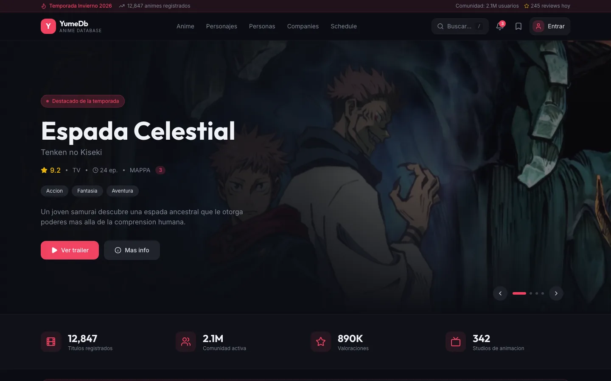
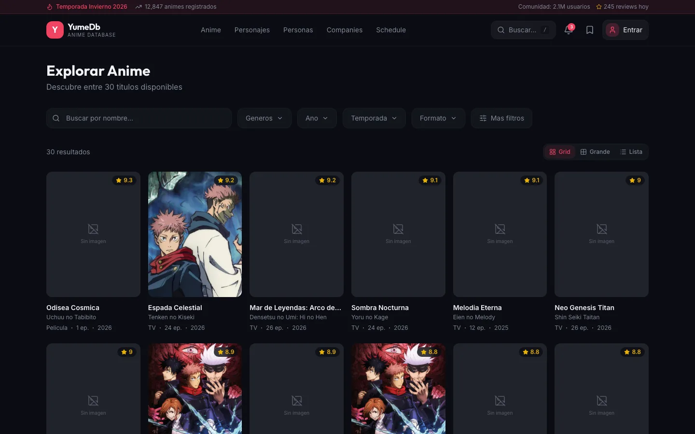
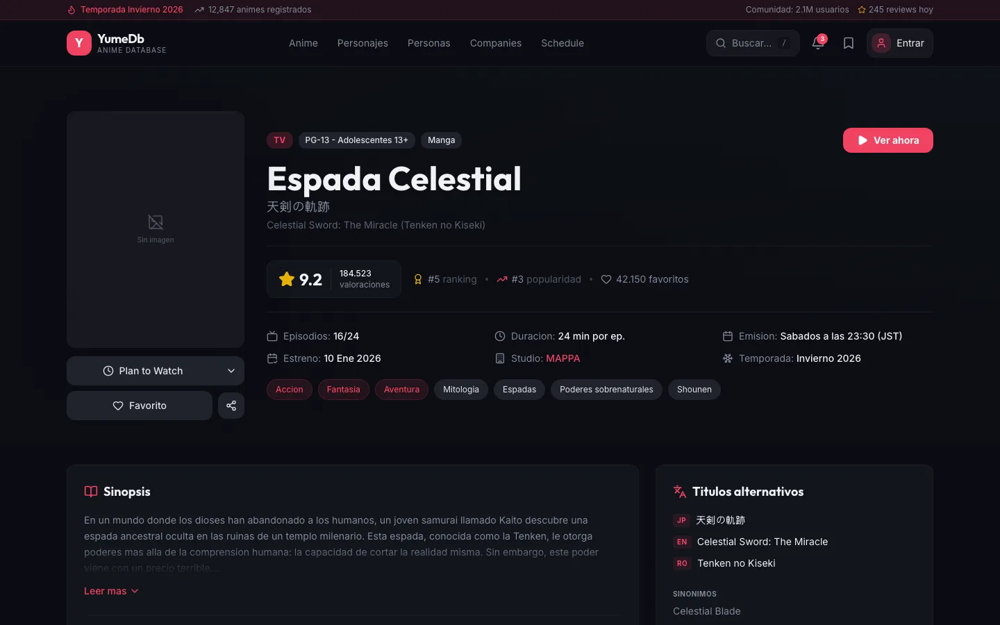
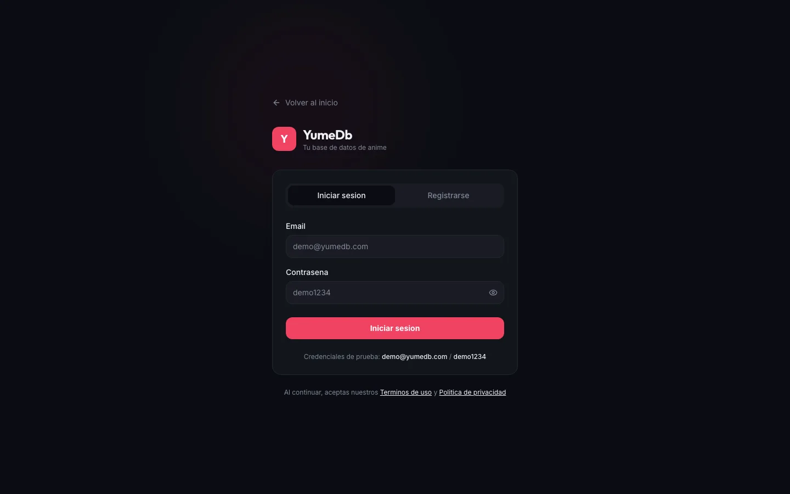
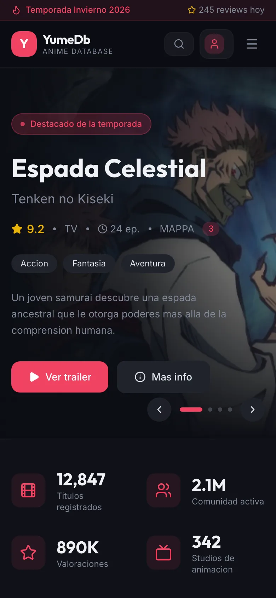

# YumeDB Lab

Two early frontend explorations for [YumeDB](https://yumedb.com), the open knowledge graph of anime and manga. Each one tries a different stack and a different data source for the same idea: browse anime, manga, characters, people and studios, follow the airing schedule and keep a personal list.

They are prototypes, kept here as a reference. The YumeDB product itself is being rebuilt from scratch in a separate, private repository.

| Folder | Stack | Data | Status |
|---|---|---|---|
| [`nextjs-frontend/`](nextjs-frontend/) | Next.js 16, React 19, Tailwind CSS, shadcn/ui | Local mock data (or a backend, optional) | Prototype, Feb–Jun 2026 |
| [`vite-frontend/`](vite-frontend/) | Vite 6, React 19, React Router, Tailwind CSS 4, Framer Motion | Live data from the public [Jikan API](https://jikan.moe) | Prototype, Apr 2026 |

The interface text is in Spanish.

## Screenshots

### Next.js frontend



| Anime list with filters | Anime detail |
|---|---|
|  |  |

| Login | Mobile |
|---|---|
|  |  |

Most covers show «Sin imagen» because the mock data only ships images for a few titles.

## Run them

You need Node.js 20 or newer.

**Next.js frontend** (uses [pnpm](https://pnpm.io)):

```bash
cd nextjs-frontend
cp .env.example .env.local
pnpm install
pnpm dev
```

It opens at http://localhost:3000 with mock data, so no backend is needed.

**Vite frontend:**

```bash
cd vite-frontend
npm install
npm run dev
```

It opens at http://localhost:3000 and reads from the Jikan API, so it needs an internet connection. Jikan has rate limits: if many requests fail at once, wait a few seconds and reload.

## What's inside

- **Next.js frontend:** home, anime list with filters, and detail pages for anime, characters, people and studios. Also an airing schedule, a user profile with custom lists, settings and a login screen. Everything runs on mock data in `lib/mock/`.
- **Vite frontend:** home with a hero slider, anime and manga lists and details, characters, people, studios, a weekly airing schedule and a command-style search. All of it reads from Jikan in real time.

## Credits

Anime and manga data in the Vite frontend comes from the [Jikan API](https://jikan.moe), an unofficial MyAnimeList API. Titles, images and names belong to their respective owners.

Made by [Vadym Koshtovnyi](https://vkoshtovnyi.com/en/).
