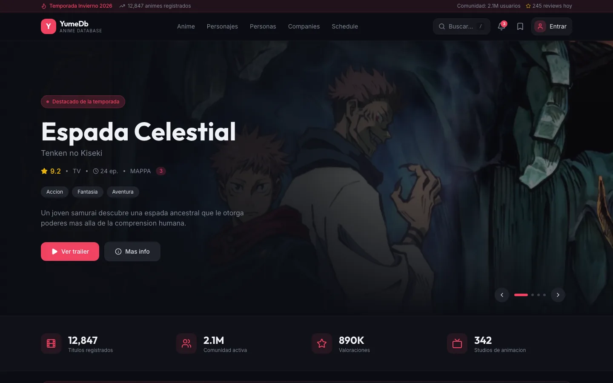
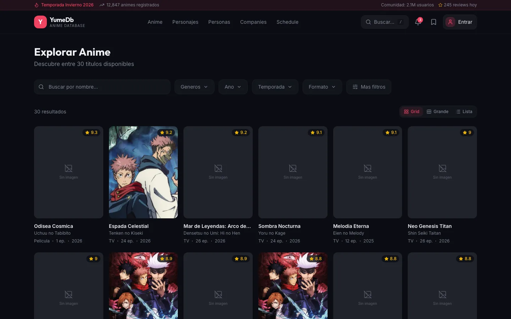
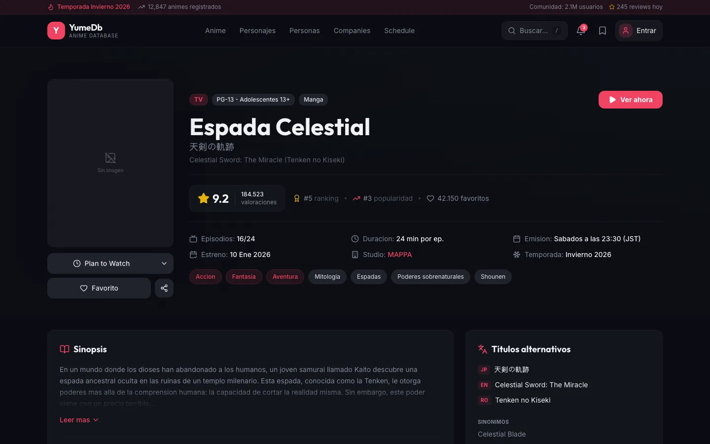
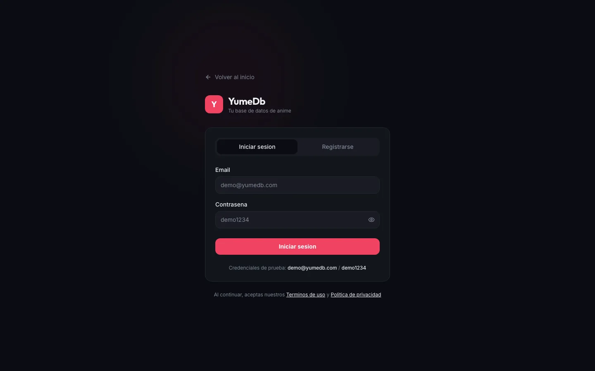
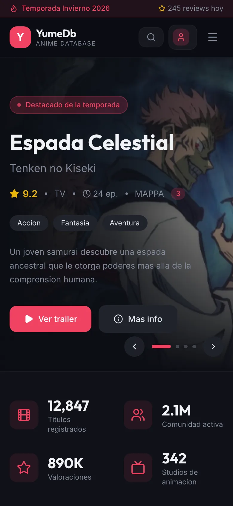

# YumeDB Lab · Next.js frontend

Next.js 16 + React 19 + Tailwind CSS + shadcn/ui prototype of the YumeDB frontend, running on local mock data.



| Anime list with filters | Anime detail |
|---|---|
|  |  |

| Login | Mobile |
|---|---|
|  |  |

Most covers show «Sin imagen» because the mock data only ships images for a few titles.

## Run it

```bash
cp .env.example .env.local
pnpm install
pnpm dev      # http://localhost:3000
pnpm build    # production build
```

Set `NEXT_PUBLIC_DATA_SOURCE=api` and `NEXT_PUBLIC_API_URL` in `.env.local` to read from a backend instead of the mock data in `lib/mock/`.

See the [main README](../README.md) for context.
