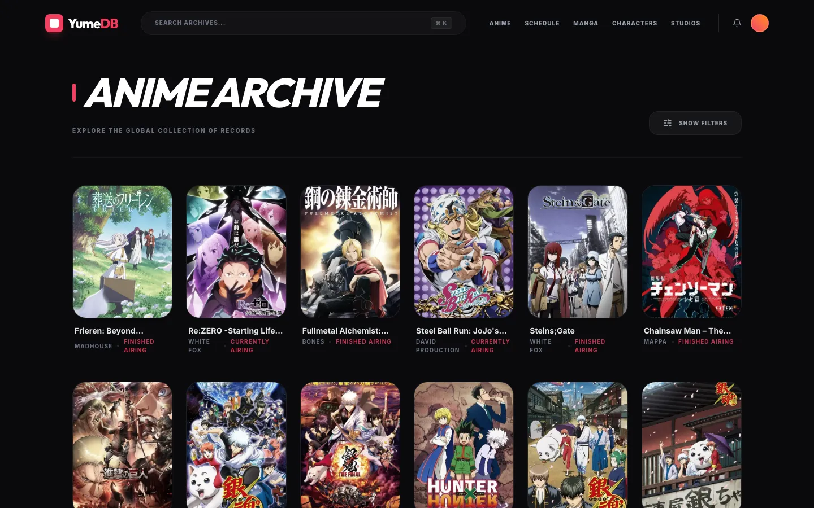
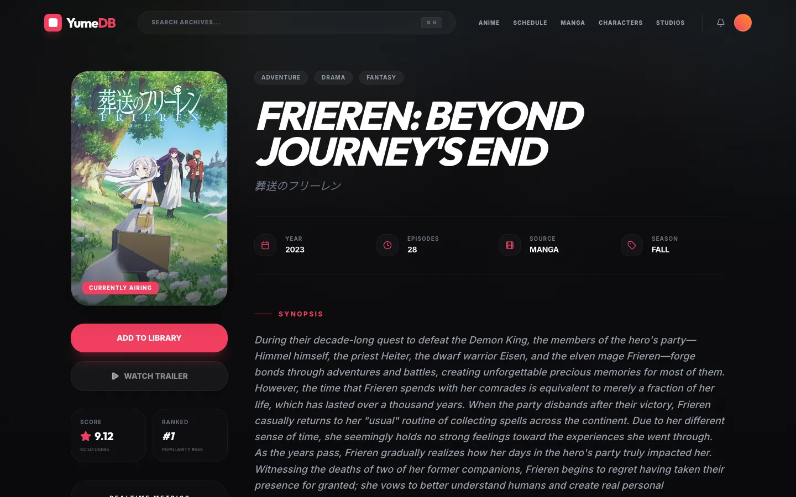
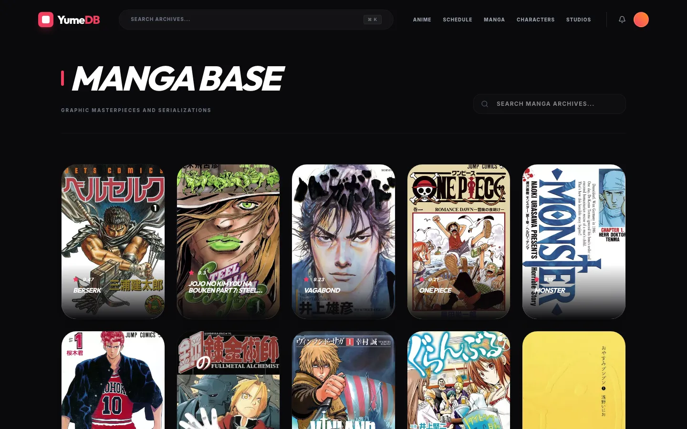
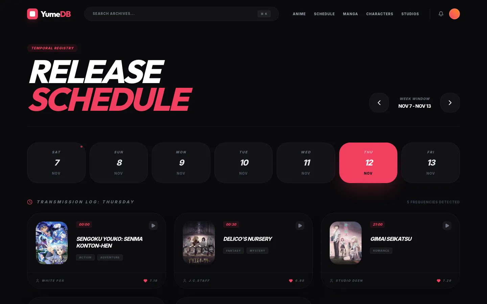
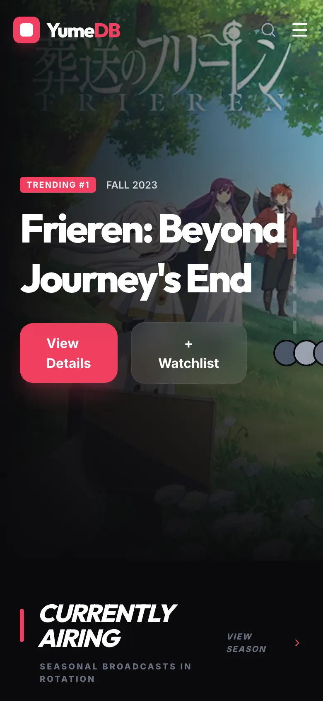

# YumeDB Lab · Vite frontend

Vite 6 + React 19 + React Router + Tailwind CSS 4 prototype of the YumeDB frontend, reading live data from the public [Jikan API](https://jikan.moe).


| Anime list | Anime detail |
|---|---|
|  |  |

| Manga list | Airing schedule |
|---|---|
|  |  |



The Jikan API was down when these were taken (November 2026), so the data comes from Internet Archive copies of its responses.

```bash
npm install
npm run dev      # http://localhost:3000
npm run build    # production build
npm run lint     # type check
```

No environment variables or API keys are needed.

See the [main README](../README.md) for context.
